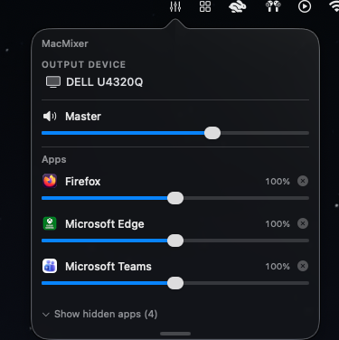

<h1 align="center">MacMixer</h1>

<p align="center">
  
</p>

<p align="center">
  A lightweight macOS menu bar <b>per-app volume mixer</b> — built on Core Audio
  process taps, so there's <b>no audio driver to install</b> and <b>no microphone
  indicator</b>.
</p>

---

## What it does

MacMixer lives in your menu bar and gives you a volume slider for **each running
app**, plus a master volume and an output-device picker:

- **Per-app volume** — independent 0–200% slider for every app that's playing
  audio. Above 100% boosts; a bolt icon and orange tint show when an app is
  boosted. Slider snaps to 100% (the app's normal level).
- **Master volume + mute** — controls the selected output device's hardware
  volume, so it affects everything.
- **Output picker** — switch the system output device from the menu, with an
  icon that reflects the device type (AirPods, headphones, speaker, display).
- **Follow new devices** — when you connect AirPods or headphones, MacMixer
  switches to them automatically (displays are ignored).
- **Hide apps** — hide apps you don't care about (utilities like Finder and
  Terminal are hidden by default); your choices are remembered.
- **Resizable** — drag the bottom edge to make the app list taller; the size is
  remembered.

## Why this exists

macOS has no public API to set another app's output volume. The well-known
solution, [Background Music](https://github.com/kyleneideck/BackgroundMusic),
is great it ships a **virtual audio driver** and captures audio by reading it back through a
virtual *input* stream — Unfortunately macOS classifies this as microphone use, so it
permanently lights the **orange microphone indicator**, requires Microphone
permission, and needs a `sudo` driver install.

macOS 14.2 added a first-class **Core Audio process-tap API**
(`CATapDescription` + `AudioHardwareCreateProcessTap`). MacMixer is built on it:

- **No virtual driver** — nothing installed in `/Library/Audio/Plug-Ins`, no
  `sudo`, no `coreaudiod` restart. Just an app.
- **No microphone indicator** — a process tap is not classified as microphone
  input, so the orange mic dot never appears.

## Requirements

- **macOS 14.2 or later** (developed on macOS 26)
- Nothing else to run it — the app links only system frameworks and the Swift
  runtime that ships with macOS. (Xcode is only needed to build from source.)

## Install (no Xcode)

1. Download `MacMixer.zip` from the
   [latest release](https://github.com/burghr/MacMixer/releases/latest), unzip it,
   and drag **MacMixer.app** into `/Applications`.
2. MacMixer isn't notarized (it's an ad-hoc-signed personal project), so macOS
   Gatekeeper blocks it the first time. To allow it:
   - **macOS 15 (Sequoia) or later:** double-click MacMixer (it gets blocked),
     then open **System Settings → Privacy & Security**, scroll to
     *"MacMixer was blocked…"*, and click **Open Anyway**.
   - **macOS 14 (Sonoma):** right-click (Control-click) MacMixer → **Open** →
     **Open**.
   - **Or in Terminal (any version):**
     ```sh
     xattr -dr com.apple.quarantine /Applications/MacMixer.app
     ```
3. Click the menu bar icon. The first time it controls an app, macOS asks to allow
   **audio recording** — grant it (see [Permissions](#permissions)).

## Build from source

```sh
git clone https://github.com/burghr/MacMixer.git
cd MacMixer
gem install xcodeproj   # one-time; build.sh uses it to generate the project
./build.sh              # generates the Xcode project, builds Release, installs to /Applications
open -a MacMixer
```

Requires **Xcode 15+**. The Xcode project is generated from `project.rb` (via the
[xcodeproj](https://github.com/CocoaPods/Xcodeproj) gem) and is git-ignored — the
Swift sources are the source of truth. The app is ad-hoc signed
("Sign to Run Locally").

## Permissions

The first time MacMixer taps an app, macOS asks for permission to **record audio**
from your Mac. This is required: changing an app's volume means capturing its
audio, applying gain, and playing it back — and macOS treats capturing another
app's audio as recording. It is **not** microphone access (no orange mic dot),
and MacMixer never touches your microphone. You can manage it in
**System Settings → Privacy & Security**.

## How it works

For each app you control, MacMixer creates a private process tap with
`CATapMutedWhenTapped` — the app's own output is muted only while we're reading
it. All taps plus the chosen output device are combined into one **private
aggregate device**, clocked by the output, and a single realtime callback mixes
every tap into the output with per-app gain applied. Because the aggregate
provides one clock, there's no ring buffer and no sample-rate drift. If the
render ever stalls, the "when tapped" mute releases and apps play normally again.

Chromium-based apps (Chrome, Edge, Electron) and others play audio from helper
processes rather than their main process; MacMixer maps every audio process
object back to its owning app (by pid or bundle-id prefix) so their sliders work
too.

```
MacMixer/
  MacMixerApp.swift       @main; menu-bar-only (LSUIElement)
  AppDelegate.swift       NSStatusItem + transient NSPopover
  PopupView.swift         SwiftUI UI
  MixerModel.swift        @MainActor ObservableObject bridging UI <-> engine
  TapEngine.swift         Core Audio engine: taps + aggregate + render mix
  CoreAudioSupport.swift  AudioObject / device / tap helpers
```

## Limitations

- macOS 14.2+ only (the process-tap API doesn't exist on earlier versions).
- Only apps with a visible slider are tapped; hidden apps play natively (master
  still affects them, since master is the device's hardware volume).
- Master/mute require an output device that exposes a hardware volume control;
  some devices (e.g. certain HDMI outputs) don't.

## License

[MIT](LICENSE) © 2026 burghr

This is original code and shares nothing with Background Music; it is not a fork.
